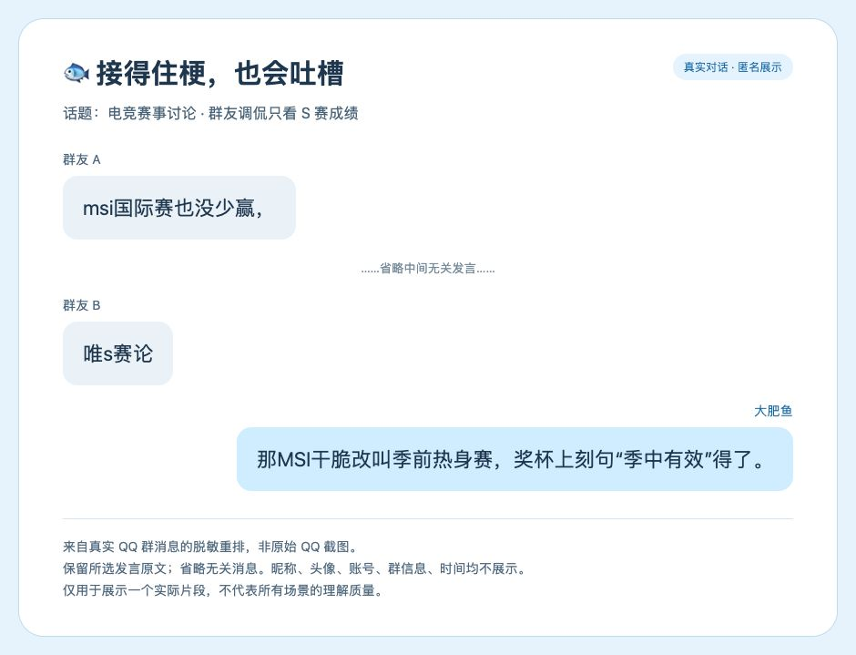
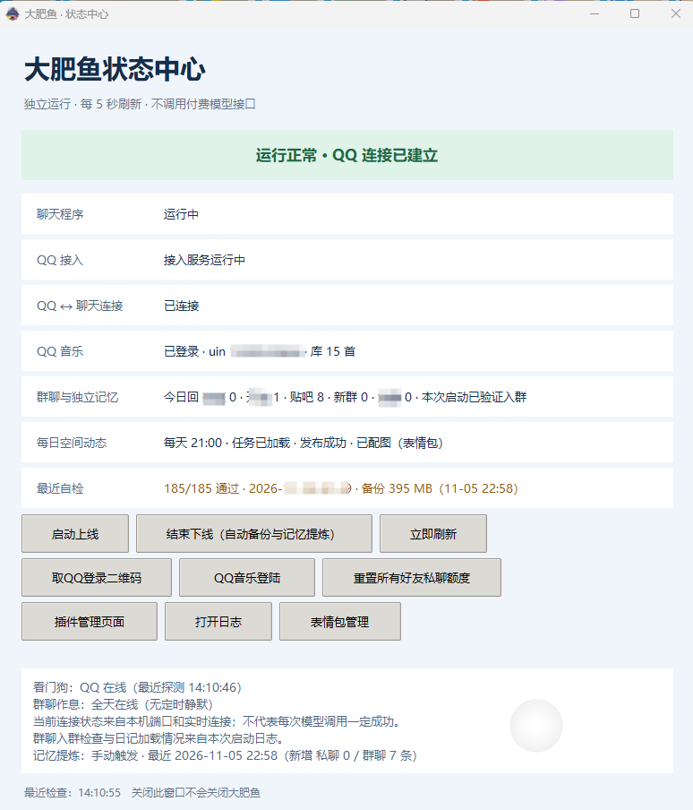

# 大肥鱼 · 安装与使用说明

大肥鱼是一个跑在 QQ 上的 AI 聊天角色。底座是 AstrBot，QQ 这边通过 NapCat 走 OneBot v11，模型接 DeepSeek 的兼容接口。

这套东西是从我自己在用的环境里整理出来的。仓库里放的是 AstrBot 源码、外层脚本和文档；`runtime/AstrBot-4.29.3/data` 被 AstrBot 自带的 `.gitignore` 挡掉了，插件、人设和配置都没进仓库，只在完整包里——所以 clone 下来是起不来的。

能直接跑的是 Release 里那个包，三百多 MB，带了 `.venv`、NapCat、ffmpeg 和内置表情。

→ [下载最新完整运行包](https://github.com/Wizard-CY/dafeiyu/releases/latest)

仓库和 Release 都只保留最新版，旧版本不单独存档；升级就直接下最新的包。

<!-- 截图放好之后取消注释，说明见 docs/SCREENSHOTS.md：


-->

先说名字，免得你看晕：项目叫大肥鱼，角色叫哦鲸鲸，仓库叫 dafeiyu，压缩包和目录叫 JingJing。都是同一个东西，早期没统一，现在改起来麻烦，就将就着用了。

包里没有账号、聊天记录、好友记忆，也没有任何登录凭据。QQ 号、群号、API Key、后台密码、OneBot token，都得你自己填。不填就启动，它是不会说话的。

维护与整理：**YunShan You**。

> 只适合自己玩。不保证可用，也不对账号、数据或第三方服务负责。完整条款见 [DISCLAIMER.md](DISCLAIMER.md)。

`docs/` 里还有几份按主题拆开的短文档（安装、配置、常见问题、截图说明），内容以这份为准。

装的时候最容易卡住的地方，我放在第 9 节了。

## 开始之前

系统得是 Windows 10 或 11，64 位。没有别的平台版本。

需要装的东西：

- Python 3.11。3.10 没试过，别赌。
- QQ NT 客户端。
- 一个单独的 QQ 小号。别拿主号，下面还会说。
- DeepSeek 或者任意 OpenAI 兼容接口的 API Key。
- Node.js 18+。只有点歌用得上，不用点歌可以不装。
- 管理员权限。NapCat 挂 QQ 要。

不用另装的：AstrBot、NapCat、ffmpeg、表情包，包里都有。启动脚本会把 `runtime/bin` 加进 PATH，ffmpeg 直接能用。

两个坑先提醒：

用程序登录 QQ 有风险，轻则限制登录，重则封号。用小号，后果自己担。

后台 6185 和 NapCat 6099 只监听本机。别往公网映射，别做端口转发。

## 1. 换掉三个号

包里所有要填 QQ 的地方，都用这三个数占位：

| 占位 | 是什么 | 填成 |
|---|---|---|
| 1000000000 | 机器人 QQ | 你的小号 |
| 1000000001 | 主人 QQ | 你自己的号 |
| 1000000002 | 群号 | 要拉它进的群 |

用 VS Code 打开整个目录，Ctrl+Shift+H 全局替换。搜索范围只圈 `runtime/**` 和 `scripts/**`，把 `README.md`、`docs/**`、`DISCLAIMER.md`、`NOTICE.md` 排除掉——这份 README 里也有这几个数，别一起替换，表格会花。

两个开关注意一下：搜索面板里把「Use Ignore Files」取消勾选，不然 `data/` 下的插件文件会被跳过（它被 AstrBot 的 .gitignore 忽略了）；替换时只换这三个十位数本身，别开正则，源码里别的数字可能刚好撞上。

带占位符的大概是这些地方：

```
scripts/start.ps1
scripts/status.pyw
runtime/AstrBot-4.29.3/data/plugins/astrbot_plugin_listen_music/
runtime/AstrBot-4.29.3/data/plugins/dafeiyu_diary/
runtime/AstrBot-4.29.3/data/plugins/dafeiyu_group/        main.py 和 helper.py 都有
runtime/AstrBot-4.29.3/data/plugins/dafeiyu_guard/
runtime/AstrBot-4.29.3/data/plugins/dafeiyu_memory/
runtime/AstrBot-4.29.3/data/plugins/dafeiyu_music/
runtime/AstrBot-4.29.3/data/plugins/dafeiyu_quota/
runtime/AstrBot-4.29.3/data/plugins/dafeiyu_qzone_reply/
runtime/AstrBot-4.29.3/data/plugins/dafeiyu_reconnect/
runtime/AstrBot-4.29.3/data/plugins/dafeiyu_style/
runtime/AstrBot-4.29.3/data/plugins/dafeiyu_voice/
runtime/AstrBot-4.29.3/data/plugins/dafeiyu_watchdog/
```

在 VS Code 里搜 `1000000000`，能把这些全捞出来，挨个看上下文改。

群名是另一件事，在 `dafeiyu_group/main.py`：

```python
GROUP_NAME = '**群'
```

把 `**群` 换成你的群名。`scripts/status.pyw` 里也有一处，一起换掉，不然状态中心显示的还是占位符。这两处只影响提示和显示，不改也能跑。

## 2. 填 API Key

打开：

```
runtime/AstrBot-4.29.3/data/cmd_config.json
```

`provider_sources` 里有两条，`deepseek` 和 `deepseek_1`，长得一样，`key` 都是空的。`provider[0].provider_source_id` 指向 `deepseek`，所以填第一条就行：

```json
"key": ["sk-你的Key"]
```

第二条留着不碍事，想删也行。

顺手检查三处：

- `provider_sources[0].enable` 是 `true`
- `provider[0].enable` 是 `true`
- `provider[0].model` 现在是 `deepseek-flash`，想换模型改这里

## 3. 后台密码和 OneBot token

后台账号是 `admin`。包里没有写死初始密码：`cmd_config.json` 里 `dashboard` 段的 `password`、`pbkdf2_password` 和 `jwt_secret` 都是空的，AstrBot 第一次启动会自己生成一个随机密码和 JWT 密钥，密码打在启动日志里：

```
Select-String startup.log "Initial password"
```

`startup.log` 在 `runtime/AstrBot-4.29.3/` 下。登录 `http://127.0.0.1:6185` 后系统会强制你先改密码（`password_change_required` 是 `true`），别跳过——用初始密码挂着的后台，等于把机器人送人。

以后忘了密码想重置，用环境变量启动一次：

```powershell
$env:ASTRBOT_RESET_DASHBOARD_PASSWORD = '1'
D:\JingJing\runtime\AstrBot-4.29.3\.venv\Scripts\python.exe D:\JingJing\runtime\AstrBot-4.29.3\main.py
```

`admins_id` 现在是空的，填上主人 QQ：

```json
"admins_id": ["1000000001"]
```

这个字段不会跟着占位符替换，得手动加。

OneBot 的 token 包里没设。打开 NapCat WebUI（`http://127.0.0.1:6099`），设一个随机 token，然后回 `cmd_config.json`：

```json
"platform": [
  {
    "id": "dafeiyu-qq",
    "type": "aiocqhttp",
    "ws_reverse_port": 6199,
    "ws_reverse_token": ""
  }
]
```

把 `ws_reverse_token` 填成一样的。只在本机用，两边都留空也行，但不建议。

参考配置在 `runtime/napcat-shell/config/onebot11.example.json`。

## 4. 本机路径

三个路径不用在 `start.ps1` 里硬改，脚本会自己找：`pythonw` 和 `node.exe` 按 PATH 和常见位置探测，QQ 的 `QQ.exe` 按常见安装位置探测。找不到时，在 `scripts/` 下新建 `paths.local.ps1`（这个文件已被 .gitignore 忽略，不会进仓库），按自己机器写三个值：

```powershell
$pythonw = 'C:\Users\你的用户名\AppData\Local\Programs\Python\Python311\pythonw.exe'
$nodeExe = 'C:\Program Files\nodejs\node.exe'
$qqPath  = 'D:\QQ\QQ.exe'
```

- `$pythonw` 用系统 Python，不是 `.venv` 里那个。
- `$nodeExe` 只有点歌用得上，不点歌可以不填。
- `$qqPath` 是 QQ NT 的 QQ.exe；路径不对，NapCat 起不来，启动结束会弹窗提示。

## 5. 检查环境，然后启动

先看自带的环境能不能用：

```powershell
D:\JingJing\runtime\AstrBot-4.29.3\.venv\Scripts\python.exe -c "import astrbot; print('ok')"
```

显示 `ok` 就跳过下面这段。

换过机器、或者报缺包的，重建虚拟环境：

```powershell
cd D:\JingJing\runtime\AstrBot-4.29.3
Remove-Item .venv -Recurse -Force
py -3.11 -m venv .venv
.\.venv\Scripts\python.exe -m pip install --upgrade pip
.\.venv\Scripts\python.exe -m pip install -r requirements.txt
```

有 uv 的话，`uv sync` 也行。

插件依赖：

```powershell
.\.venv\Scripts\python.exe -m pip install edge-tts aiohttp requests
```

状态中心用的是系统 Python，不是虚拟环境：

```powershell
C:\Users\你的用户名\AppData\Local\Programs\Python\Python311\python.exe -m pip install pystray Pillow
```

装完可以先单独跑一下 AstrBot，能起来就停掉，再去配 NapCat：

```powershell
cd D:\JingJing\runtime\AstrBot-4.29.3
.\.venv\Scripts\python.exe main.py
```

然后管理员运行：

```powershell
D:\JingJing\scripts\start.ps1
```

或者双击 `scripts\start.cmd`。

它会依次拉起 AstrBot、QQ 音乐后端、NapCat（会弹 QQ 登录窗）和状态中心托盘。已经在跑的端口会跳过，不会重复开。

NapCat 的 WebUI 在 `http://127.0.0.1:6099`，「网络配置」里填：

```
WebSocket 客户端
URL: ws://127.0.0.1:6199/ws
Token: 和 cmd_config.json 里的 ws_reverse_token 一致
```

登录之后 NapCat 会自己生成账号配置，不用手动放文件。

看到这行日志，就通了：

```
aiocqhttp(OneBot v11) 适配器已连接
```

状态中心里「QQ 接入」变绿是同一个意思。

启动后状态中心默认缩在托盘里，单击右下角的鲸鱼图标打开。看不到就点任务栏的 `^`。窗口右上角那个关闭只是收回托盘，真要退出是右键托盘图标 →「退出托盘」。

要下线就用状态中心的「结束下线」：它会给近 12 小时私聊过的好友发一句「我要下线啦，明天再来聊天吧」，然后提炼记忆、备份、关进程。命令行里的 `scripts/stop.ps1` 做的是后面三件事，不发通知。

## 6. 它现在会什么

私聊：

- 正常聊天、接情绪、吐槽、简单问答。
- 每个好友每天 75 条回复额度，按实际发出去的消息算。
- 被问到加群、新功能、投喂、主人身份、技术问题、token、联系方式，会按固定话术回。
- 被夸可爱或漂亮，会傲娇一下，最多两个来回。
- 戳一戳会戳回来，或者回一句。
- 会发表情包、语音条，能点歌。

群聊只有一个群，多了不管。

- 只在被 @、被引用回复，或者消息里叫「大肥鱼 / 哦鲸鲸 / 鲸鲸」时说话。
- 每天 200 条，每小时 30 条封顶。
- 群记忆和私聊分开。
- 群里不报联系方式，不聊主人隐私，不接技术细节。

其它：

- 人设是哦鲸鲸，DeepSeek 拟人蓝鲸娘。
- 语音用 Edge TTS 加 ffmpeg。
- 表情包会自动收集，也有内置的，还能自己往目录里丢。
- 点歌先找本地曲库，再走 QQ 音乐后端，最后 B 站兜底。
- 空间动态每天 21:00 左右生成发布。
- 22:00 提炼私聊好友记忆和群记忆。
- 支持手动或定时 zip 备份。
- 托盘状态中心，能看状态、取二维码、重连、下线。
- 断线重连、看门狗、联网搜索、听语音。

## 7. 想改的话，改哪里

下面凡是写 `data/` 的，都指 `runtime/AstrBot-4.29.3/data/`。

人设：

```
runtime/AstrBot-4.29.3/data/dafeiyu_character.md
assets/persona.md
```

角色管主人叫「主人」，别改成别的称呼，护栏里是按这个写的。

私聊额度：

```
runtime/AstrBot-4.29.3/data/dafeiyu_quota_config.json
```

默认 75 条一天，`grace_minutes` 是 0，新好友立刻回复。按发出去的回复计数。

群聊：

```
runtime/AstrBot-4.29.3/data/plugins/dafeiyu_group/main.py
```

```python
GROUP = '1000000002'
GROUP_NAME = '**群'
GROUP_HOURLY = 30
GROUP_DAILY = 200
```

只做私聊的话，把 `ALLOWED_GROUPS` 留成占位，别把机器人拉进群就行。

语音：

```
runtime/AstrBot-4.29.3/data/dafeiyu_voice.json
```

```json
{
  "enable": true,
  "voice": "zh-CN-XiaoyiNeural",
  "rate": "+6%",
  "pitch": "+18Hz",
  "private_chance": 0.25,
  "group_chance": 0.05,
  "max_chars": 40,
  "daily_cap": 30
}
```

`private_chance` 是私聊转语音概率，`group_chance` 是群聊的，`daily_cap` 是每天上限，`max_chars` 是超过多少字不转，`voice` 是 Edge TTS 音色。

断线重连：

```
runtime/AstrBot-4.29.3/data/dafeiyu_reconnect.json
```

`enable` 控制开关，`dry_run` 设成 `true` 就只记日志不发消息，想先观察一阵可以这么用。

表情包放这三个地方：`data/stickers`、`data/collected_stickers`、`data/collected_stickers/大肥鱼表情包`。最后一个是你手动丢的，不参与自动淘汰。

点歌要 Node.js 18+、`backend/qqmusic/server.mjs`，状态中心里登录 QQ 音乐，本地曲库可选。

空间动态靠 NapCat 的 `get_cookies` 拿 `user.qzone.qq.com` 的 cookie。第一次登录后重启一次 AstrBot，日志出现 `Whale diary readiness OK` 就成了（日志是英文的，正常）。每天 21:00 左右检查发布。

记忆在 `data/memory` 和 `data/dafeiyu_group_memory.md`，每天 22:00 提炼。新装是空的。

备份：

```powershell
D:\JingJing\runtime\AstrBot-4.29.3\.venv\Scripts\python.exe D:\JingJing\scripts\backup.py
```

输出到 `runtime/backups`，留最近 8 份，不含 QQ 音乐 cookie。

## 8. 被问到这些，它会这么答

- 加群：`我没有权限哦，去联系我的主人试试吧！`
- 新功能：`应该会的吧，你可以去联系我的主人问问呀！`
- 加饭 / 投喂：`可以去找我的主人`
- 主人是谁：`我只有主人`
- 主人称呼：`主人就是主人`
- 技术问题：`我只会聊天，请联系主人处理`
- token 投喂：`你真有这个心的话，那你联系我的主人吧`
- 联系方式：先问「你要我主人的QQ号吗？」，对方同意才给
- 剩余额度：`我还能发送N次消息。`

这些在私聊的护栏里直接生效。群聊只用「主人称呼」那一条，不主动说主人是谁。

最后一条我得说一句：私聊里同意就把主人 QQ 给出去，等于把号交给任何陌生人。介意的话，把这条改成给一个专门的联系方式，或者直接不给。

## 9. 出问题先看这里

状态中心没出现：

1. 看任务栏右下角的 `^`，托盘图标可能被折叠了。
2. 系统 Python 装了 `pystray` 和 `Pillow` 没有。
3. 手动跑 `pythonw D:\JingJing\scripts\status.pyw` 看报什么错。

QQ 没连上：

1. QQ 登录了没有。
2. `http://127.0.0.1:6099` 能不能打开。
3. OneBot 地址是不是 `ws://127.0.0.1:6199/ws`。
4. 两边的 token 一不一致。
5. `cmd_config.json` 里平台 id 还是不是 `dafeiyu-qq`。

私聊不回：

1. 机器人 QQ 和主人 QQ 填反了没有。
2. 是不是把 `grace_minutes` 调大了，新好友还在等待期（默认 0）。
3. 额度用完了没有。
4. 状态中心的连接状态正不正常。

群聊不回：

1. 群号换成真实的没有。
2. 机器人在不在群里。
3. 有没有 @、引用或者叫名字。
4. `ALLOWED_GROUPS` 里包含这个群没有。
5. 是不是撞了每小时 30 条、每天 200 条的上限。

点歌没声音：

1. 3311 的 Node 后端跑起来没有。
2. QQ 音乐登录了没有。
3. ffmpeg 在不在（`runtime/bin`）。

语音出不来：

1. `dafeiyu_voice.json` 里 `enable` 是不是 `true`。
2. 是不是超过 `daily_cap` 了。
3. 是不是命中了隐私、主人、技术问题这些不转语音的规则。
4. `edge-tts` 装了没有。

想回到刚装好的状态，删掉这些再重启：

```
data/memory/*
data/dafeiyu_group_memory*
data/dafeiyu_friends.json
data/dafeiyu_quota.json
data/dafeiyu_private_outbox.json
data/data_v4.db
```

`cmd_config.json`、`dafeiyu_character.md` 和几个配置文件别删，删了得重新填。

## 10. 安全

- 后台密码第一次登录就改，系统本来也会提示你。
- OneBot token 和 NapCat WebUI 的 token 用随机值。
- API Key 只放本机，别发出去。
- 6185 和 6099 不要暴露公网。
- 机器人用小号。
- 主人 QQ 不要写进群公告或公开文档。
- 群只留一个，别让它被拉进陌生群。

## 11. 许可和第三方

这个仓库按 AGPL-3.0 发布，全文在 [LICENSE](LICENSE)。GitHub 上会显示成 AGPL-3.0。

但包里不是所有东西都是 AGPL：

- `runtime/AstrBot-4.29.3` 是 AstrBot 4.29.3，本来就走 AGPL-3.0，版权归 Soulter 和贡献者。
- NapCat 用的是它自己的 Limited Redistribution License，禁止商用，再分发要带许可全文。
- ffmpeg 是 GPLv3 构建，再分发要附 GPLv3 全文和源码获取方式。
- `astrbot_plugin_listen_music` 上游没写许可证，严格说没有明确授权。
- 其余组件和 Python 依赖各走各的许可。

具体清单、版本和注意事项都在 [NOTICE.md](NOTICE.md)，许可证文本放在 `LICENSES/`。

QQ 账号、QQ 音乐账号和 API Key 都是你自己提供的。要二次分发，先把 NOTICE 看完。

## 附：装好之后目录长这样

```
D:\JingJing
├─ README.md
├─ DISCLAIMER.md
├─ .gitignore
├─ docs
│  ├─ INSTALL.md
│  ├─ CONFIGURATION.md
│  └─ TROUBLESHOOTING.md
├─ assets
│  ├─ icon.ico
│  └─ persona.md
├─ scripts
│  ├─ start.ps1
│  ├─ start.cmd
│  ├─ stop.ps1
│  ├─ status.pyw
│  └─ backup.py
├─ runtime
│  ├─ AstrBot-4.29.3
│  │  ├─ main.py
│  │  ├─ .venv
│  │  ├─ requirements.txt
│  │  └─ data
│  │     ├─ cmd_config.json
│  │     ├─ plugins
│  │     ├─ dafeiyu_character.md
│  │     ├─ dafeiyu_quota_config.json
│  │     ├─ dafeiyu_voice.json
│  │     ├─ dafeiyu_reconnect.json
│  │     ├─ stickers
│  │     └─ collected_stickers
│  ├─ napcat-shell
│  └─ bin
├─ backend
│  └─ qqmusic
└─ data
   └─ music_library
```

就这些。装的时候卡住了，先看第 9 节；还不行，开个 Issue，把日志和报错贴上来。
