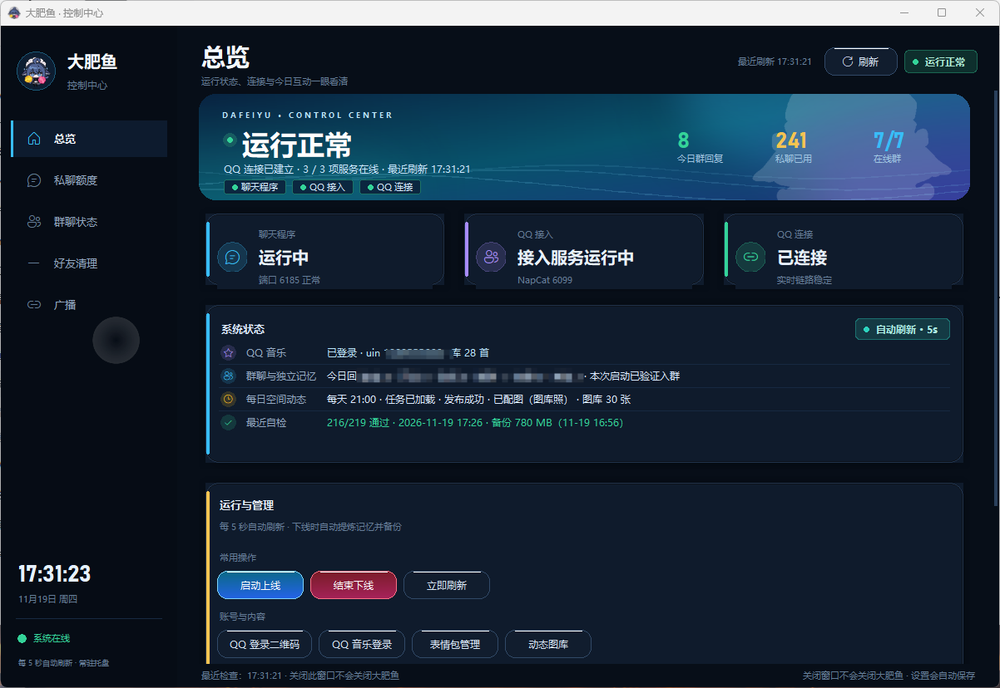

# 大肥鱼 DaFeiYu

QQ 上的一个 AI 聊天角色。底座是 [AstrBot](https://github.com/AstrBotDevs/AstrBot)，QQ 走 [NapCat](https://github.com/NapNeko/NapCatQQ) 的 OneBot v11，模型接 DeepSeek 或任意 OpenAI 兼容接口。

她不是客服，也不是通用助手。会接梗、会吐槽、会装死；人设、口头禅和边界都写在 [`assets/persona.md`](assets/persona.md)，你可以改成自己的。

这个包最早是给自己用的，后来插件越写越多，就整理成了现在这样。**只适合自己玩，别拿主号上。**

## 三分钟跑起来

> 实际第一次大概 15 分钟，时间主要花在装 QQ 和扫码上。

1. 去 [Releases](https://github.com/Wizard-CY/dafeiyu/releases/latest) 下载完整包（689 MB），解压到短一点的英文路径。2.0.0 的包解出来是 `2.0版本\` 目录。
2. 双击 `scripts\setup.cmd`，按提示填机器人 QQ、主人 QQ、API Key。
3. 装 QQ **9.9.36**（NapCat 只支持到这一版），关掉 QQ 自动更新。2.0.0 包里带了安装包，路径是 `runtime\installer\QQ_9.9.36_260924_x64_01.exe`（后续版本默认不再附带）；不放心来源的话，自己找同版本官方安装包也行。
4. 双击 `scripts\start.cmd`，会弹一次 UAC；QQ 登录窗口出来以后，用机器人小号扫码。
5. 浏览器打开 `http://127.0.0.1:6099` 配 OneBot（`ws://127.0.0.1:6199/ws`），把机器人拉进群，在控制中心「群聊状态」里给她放权。

看到 `runtime\AstrBot-4.29.3\startup.log` 里出现 `aiocqhttp(OneBot v11) 适配器已连接`，就是通了。

装的时候卡住，先看 [docs/TROUBLESHOOTING.md](docs/TROUBLESHOOTING.md)；还不行，跑 `scripts\diagnose.cmd` 生成诊断报告，再去 [Issues](https://github.com/Wizard-CY/dafeiyu/issues) 说。

## 她会什么

- 私聊聊天、安慰、讲题、翻译/改写；每个好友每天 75 条，主人不限量。
- 群聊：@ 和引用必回，普通消息按概率接话；每个群独立记忆，默认 120 条/天。
- 表情包、语音条、点歌（QQ 音乐优先，B 站兜底）。
- 每天 21:00 左右发一条空间动态，会回自己动态下的评论。
- 记忆：私聊/群聊分开记，每天 22:00 提炼，下线前也会先提炼再备份。
- 托盘控制中心：看状态、改额度、给群放权、备份、登录 QQ 音乐。

更细的说明在 [docs/CONFIGURATION.md](docs/CONFIGURATION.md)。

## 使用前请注意

- 只支持 Windows 10/11 x64；QQ 必须 9.9.36，升级就断。
- 用程序登录 QQ 有被限制或封号的风险，别用主号。
- 需要 DeepSeek 或 OpenAI 兼容接口的 API Key，会产生费用。
- 路径太长或含特殊字符时，NapCat 注入可能失败；换短英文路径。
- 私聊里对方明确索要时，她默认会把你的 QQ 给对方（`assets/persona.md` 第 31 行）。不想这样就把那段删掉。
- 个人项目，随缘维护；Issue 会看，不保证当天回。

## 仓库里有什么

- `plugins/`：18 个 `dafeiyu_*` 插件的源码，改她主要改这里。
- `scripts/`：启动、配置、备份、控制中心。
- `docs/`：安装、配置、排障、隐私、升级。
- `runtime/AstrBot-4.29.3/`：AstrBot 4.29.3 的源码。
- `assets/`：图标、人设、截图。

完整运行包（Python 3.12、Node、ffmpeg、NapCat；2.0.0 还带了 QQ 安装包）在 Releases，不进 git。原因很实际：太大，而且 NapCat 和 QQ 的再分发各有各的限制。

## 文档

- [安装](docs/INSTALL.md)
- [配置](docs/CONFIGURATION.md)
- [排障](docs/TROUBLESHOOTING.md)
- [隐私](docs/PRIVACY.md)
- [从 1.0.1 升级](docs/UPGRADE.md)

## 反馈

- Bug：用 [Bug 模板](https://github.com/Wizard-CY/dafeiyu/issues/new?template=bug_report.yml)，附版本和日志；诊断报告里的路径、QQ、Key 记得打码。
- 安全问题：别开公开 Issue，看 [SECURITY.md](SECURITY.md)。
- 想改代码：看 [CONTRIBUTING.md](CONTRIBUTING.md)。

## 许可与致谢

本仓库代码按 [AGPL-3.0](LICENSE) 发布。完整包里的第三方组件另有许可：

- AstrBot 4.29.3：AGPL-3.0，版权归 Soulter 和贡献者。
- NapCat 4.18.42：Limited Redistribution License，禁止商用，再分发要带许可全文。
- ffmpeg 7.1：GPLv3 构建，再分发要附 GPLv3 全文和源码获取方式。
- CPython 3.12：PSF License。
- qqmusic-api-enhanced 1.0.8：MIT AND Apache-2.0。
- `dafeiyu_diary`（空间动态）：MIT，© 2026 cube-lover，许可文本在 `plugins/dafeiyu_diary/LICENSE`。
- QQ NT 9.9.36：腾讯的软件，不授予再分发许可。
- `astrbot_plugin_listen_music`：上游未声明许可证。2.0.0 包里还带着，下个版本会移除或替换；你要再分发这个包，先把它删掉。

完整清单在 [NOTICE.md](NOTICE.md)，许可文本在 [`LICENSES/`](LICENSES/README.md)。

AGPL 允许商用，但完整包里的 NapCat 不允许。所以：**代码可以商用，这个整合包不行。**

## 支持这个项目

如果它帮你省了一个下午，可以在 [爱发电](https://ifdian.net/a/DaFeiYu__YunShan_You) 请我喝杯咖啡。赞助是支持维护，不是购买授权，也不影响功能。

---

维护：YunShan_You（悠云山） · 2.0.0
